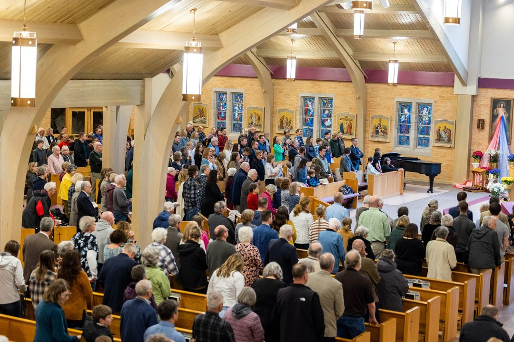
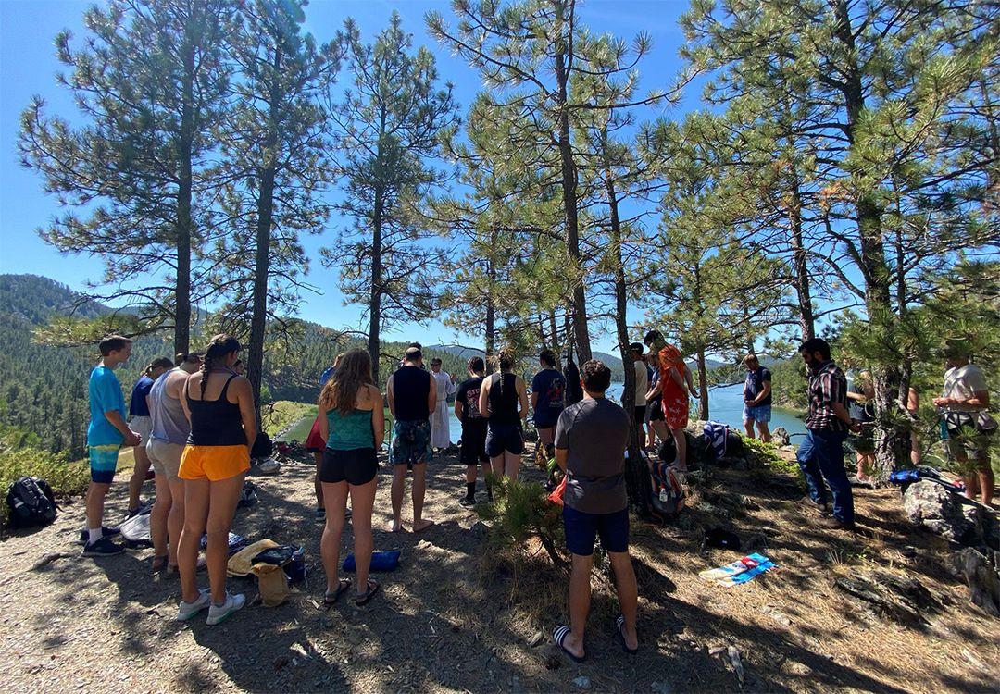
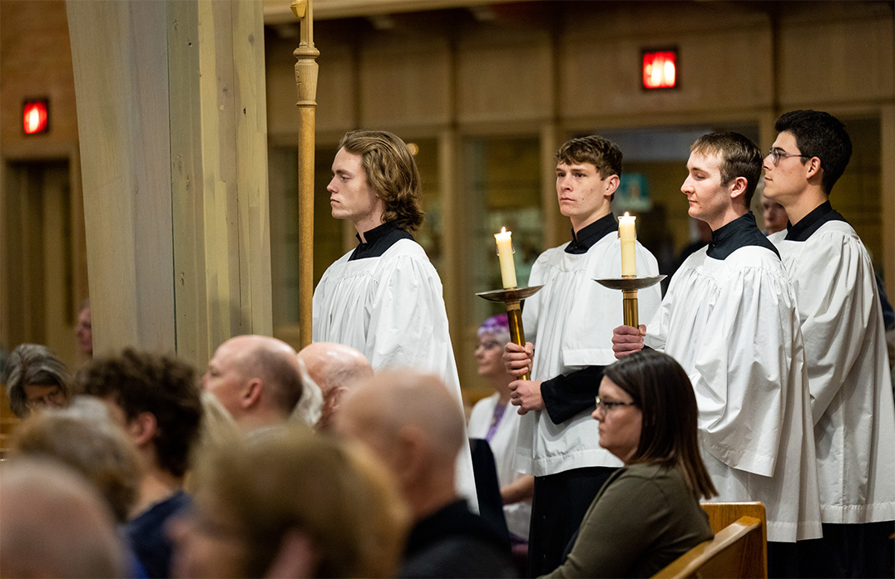
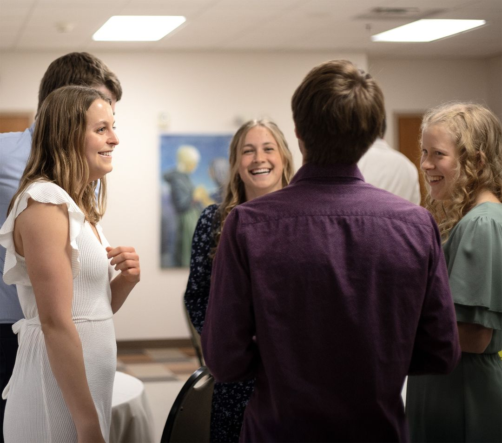

<!--
About page copy. Shown on the site's About page, exactly as written.
Written by Joseph (2026-11-14 scroll version: his outline and words; AI fixed grammar and
spelling and laid it out). See docs/vision.md, "About and Donate pages".

Format (the engine reads only this):
- A line with just --- starts a new scroll section. The first section is the opening screen.
- "# " big heading, "## " smaller heading, *text* italic, [text](url) a link.
- "> " a quote; a following line starting with "— " is who said it (may hold a link).
  A section of only quotes is set on navy; two quotes there sit side by side.
-  a picture from packs/bible-catholic/about/.
  Pictures next to each other (no blank line) sit side by side.
- "~ " a line of text that runs along a wave and moves as you scroll (use for one short phrase).
- Paragraphs light up word by word as you scroll; in a section with no heading the first one is set large.
- A section with pictures keeps them pinned beside the text; they change as you scroll.
- A blank line starts a new paragraph. Comments like this one are for editors and never shown.

Sources: Israel = Genesis 32:28. Thérèse quote: Catechism of the Catholic Church 2558,
quoting her Manuscrits autobiographiques C 25r. Carlo quote: widely quoted; wording varies
between translations (Catholic World Report, 2023-10-12, linked below).
Photos: St. Carlo Acutis Catholic Student Center, Rapid City (stcarlocsc.org). PERMISSION TO
REUSE STILL TO BE ASKED (on main since 2026-11-14 at Joseph's call).
-->

# Is the Bible trustworthy?

---

Information in books is hard to picture.

For the everyday reader, that means missing a whole dimension of study: **the timeline** and **the geography**.

---

## Israel

~ one who wrestles with God

*Yisra'el* · "one who wrestles with God" ([Genesis 32:28](https://www.biblegateway.com/passage/?search=Genesis+32%3A28&version=RSVCE))

Carlo's Compass is a tool for people wrestling with God: put the events of Scripture on the map and the timeline, side by side with the rest of history, and see for yourself.

---

## This is no substitute for time with God.

It should never replace the great depth of the faith. A loving community, prayer, and more prayer should always come first.

---

> When we face the sun, we get a tan. But when we place ourselves before Jesus in the Eucharist, we become saints.
— St. Carlo Acutis ([as quoted](https://www.catholicworldreport.com/2023/10/12/the-eucharist-is-my-highway-to-heaven/))

> For me, prayer is a surge of the heart; it is a simple look turned toward heaven, it is a cry of recognition and of love, embracing both trial and joy.
— St. Thérèse of Lisieux ([Catechism 2558](https://www.vatican.va/archive/ENG0015/__P8Z.HTM))

---

## How it started

St. Carlo created a website to show Eucharistic miracles, to spread the faith and make it more accessible.

Since then, students at the [St. Carlo Acutis Catholic Student Center](https://stcarlocsc.org) in Rapid City have followed in his footsteps. Carlo's Compass was created to help visualize the historicity of Christianity, and to compare its events with the rest of history.

